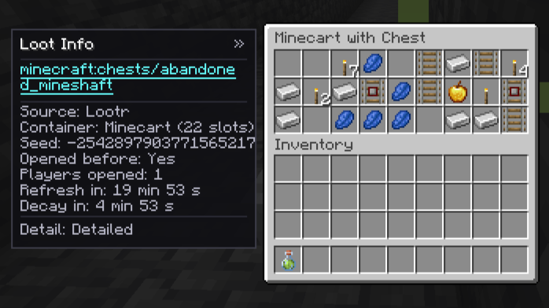

# Container Loot Tip

English | [简体中文](README.zh-CN.md)

[](LICENSE) [](#) [](#)

Displays the source loot table and basic container info on the left side of container GUIs. When installed alongside **Advanced Loot Info (ALI)** and **JEI / EMI**, the loot table ID becomes a clickable link that opens the corresponding ALI page directly.



## ✨ Features

- **Collapsible Info Panel**: Adds a **toggleable** panel to the left side of container screens that use loot tables.
- **Detailed Metadata**: Displays the loot table ID, source (`Vanilla` / `Lootr`), container type, and slot count. Easily toggle between **Compact** and **Detailed** views.
- **One-Click Lookup**: When ALI + ACI and JEI or EMI are present, clicking the loot table ID opens its exact loot table page in JEI/EMI.
- **Lootr Integration**: Displays opener counts, refresh and decay timers for Lootr containers when available.
- **Persistent Preferences**: Panel collapse state and detail level are saved globally in the client configuration.

## 📦 Installation & Compatibility

- **Minecraft 1.20.1** — Forge
- **Minecraft 1.21.1** — NeoForge

### Environment Support

| Environment | Behavior |
| --- | --- |
| **Client + Server** | **Recommended**. Full functionality enabled. |
| **Server-Only** | Compatible. Custom payloads are only sent to clients with the mod installed; vanilla clients can join normally. |
| **Client-Only** | Inert. The mod loads safely without crashing, but the panel will not appear since loot table data must be sent by the server. |

### Optional Dependencies

All integrations are completely optional. The mod runs standalone and enables features dynamically based on installed mods:

| Mod | Purpose | Behavior When Missing |
| --- | --- | --- |
| **Lootr** | Preserves per-player loot and provides opener, refresh, and decay info | Vanilla containers still work, but tables are only visible on first open |
| **ALI + ACI** | Provides loot table detail pages (*Advanced Loot Info* & *Advanced Core Info*) | Table ID and basic info are shown, but the ID is not clickable |
| **JEI or EMI** | Displays ALI pages (either one works; REI is not planned) | Same as above; table ID is not clickable |

## ⚠️ Known Limitations

- **Vanilla Container Consumption**: Vanilla Minecraft consumes and clears a container's loot table tag the moment it is opened for the first time. Because this mod captures the table on the server during that initial open event, **vanilla containers only show the panel the very first time they are opened** (containers opened prior to installing the mod cannot be recovered). Use **Lootr** if you want persistent loot table info.
- **Supported Containers**: Containers without a GUI are not supported, and the mod does not attempt to infer loot tables for custom containers outside of Vanilla and Lootr.

## 🛠️ Building & Development

### Branches

- `main`: Shared code (`src/common`), documentation, and conventions (not a runnable Gradle project).
- `1.20.1-forge`: Minecraft 1.20.1 Forge project (requires **JDK 17**).
- `1.21.1-neoforge`: Minecraft 1.21.1 NeoForge project (requires **JDK 21**).

### Local Development Dependencies

Companion mods are compiled against local jars placed in `.deps/<branch>/` (git-ignored). Download the required versions matching the properties in that branch's `gradle.properties`:

- `lootr`, `ali`, `aci`, `jei`, `emi` (used strictly for compilation and dev runtime; never bundled).

### Gradle Commands

Check out the target branch (`1.20.1-forge` or `1.21.1-neoforge`) and run:

```bash
# Build the mod (artifacts output to build/libs/)
./gradlew build

# Launch dev client (loads JEI by default; append -Pwith_emi=true to also load EMI)
./gradlew runClient

# Build using the NeoForge mirror if maven.neoforged.net is unreachable
./gradlew build -Pneoforge_mirror=[https://neoforged.forgecdn.net](https://neoforged.forgecdn.net)
```

## 📄 License

Licensed under the [MIT License](https://www.google.com/search?q=LICENSE).
