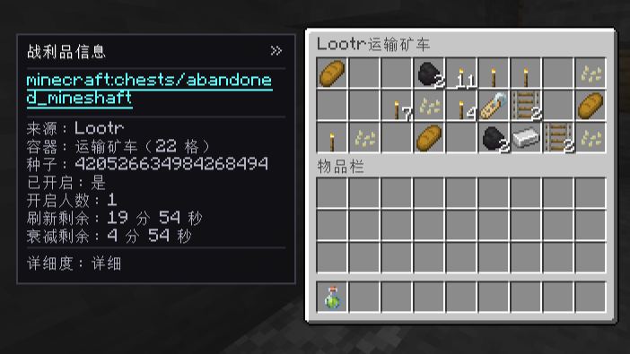
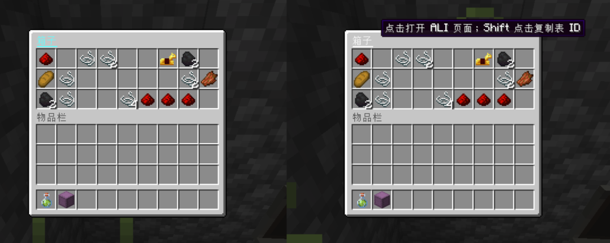

# 战利品箱信息提示 (Container Loot Tip)

[English](README.md) | 简体中文

[](LICENSE) [](#) [](#)

在带战利品表（Loot Table）的容器界面侧边显示战利品表来源与基础信息，也可以只把容器标题变成链接。配合 **Advanced Loot Info (ALI)** 与 **JEI / EMI** 使用时，可直接点击表名或标题跳转到对应的战利品表详情页。





## ✨ 功能特性

- **侧边信息面板**：打开带战利品表的容器时，在 GUI 左侧或右侧显示**可折叠**的信息面板。
- **多维信息展示**：显示战利品表 ID、来源（原版 / Lootr）、容器类型与槽位数；支持在**简洁**与**详细**模式间切换。
- **标题链接模式**：可以完全隐藏侧栏，只把容器标题变成超链接。
- **一键跳转查询**：安装 ALI + ACI 及 JEI / EMI 时，点击战利品表 ID 或容器标题即可精确打开该表的 ALI 战利品详情页。
- **复制表 ID**：Shift 点击战利品表 ID 或容器标题即可复制到剪贴板。
- **Lootr 深度支持**：查看 Lootr 容器时，额外显示开启人数、刷新与衰减倒计时等信息。
- **全局状态记忆**：面板模式、侧边位置、折叠状态与详细度会全局保存，并可通过配置文件或客户端命令修改。

## 📦 支持版本与安装

- **Minecraft 1.20.1** — Forge
- **Minecraft 1.21.1** — NeoForge

### 端侧要求

| 安装环境 | 运行表现 |
| --- | --- |
| **客户端 + 服务端** | **推荐**。完整支持所有面板显示与跳转功能。 |
| **仅服务端** | 兼容。服务端不会向未安装本模组的客户端发送自定义数据包，原版客户端可正常进服。 |
| **仅客户端** | 不生效。模组可正常加载不崩溃，但因缺少服务端下发的战利品表数据，不会显示面板。 |

### 软依赖与联动（全部可选）

本模组无需任何前置即可独立运行，安装以下模组可解锁完整体验：

| 联动模组 | 作用 | 未安装时的表现 |
| --- | --- | --- |
| **Lootr** | 保留玩家独立战利品，提供开启人数、刷新与衰减信息 | 仅支持原版容器（受限于原版机制，仅首次打开可见） |
| **ALI + ACI** | 提供战利品表详情页数据（Advanced Loot / Core Info） | 正常显示面板与表名，但表名无法点击跳转 |
| **JEI 或 EMI** | 渲染并展示 ALI 页面（二选一即可，不计划支持 REI） | 同上，表名无法点击跳转 |

## ⚙️ 配置

客户端选项保存在 `config/container_loot_tip-client.json`。游戏内不提供设置界面，可以通过配置文件或客户端命令修改。

```json
{
  "panelMode": "SIDEBAR",
  "panelSide": "LEFT",
  "collapsed": false,
  "detailLevel": "COMPACT"
}
```

| 配置项 | 可选值 | 默认值 | 说明 |
| --- | --- | --- | --- |
| `panelMode` | `SIDEBAR`、`TITLE_LINK` | `SIDEBAR` | 完整侧栏，或仅把容器标题变成链接 |
| `panelSide` | `LEFT`、`RIGHT` | `LEFT` | 侧栏所在位置；`TITLE_LINK` 模式下忽略 |
| `collapsed` | `true`、`false` | `false` | 侧栏折叠状态；`TITLE_LINK` 模式下忽略 |
| `detailLevel` | `COMPACT`、`DETAILED` | `COMPACT` | 侧栏显示的信息量 |

配置值不区分大小写；缺失或无效值会回退到默认值。配置必须是合法 JSON，不支持注释。配置文件会在模组首次保存偏好时自动创建。

| 命令 | 说明 |
| --- | --- |
| `/container_loot_tip mode <SIDEBAR\|TITLE_LINK>` | 在侧栏和标题链接模式之间切换 |
| `/container_loot_tip side <LEFT\|RIGHT>` | 调整侧栏位置 |
| `/container_loot_tip detail <COMPACT\|DETAILED>` | 调整侧栏详细度 |
| `/container_loot_tip collapse <true\|false>` | 折叠或展开侧栏 |

命令会立即更新游戏内设置，并将完整配置写回同一个 JSON 文件；直接编辑配置文件则在客户端启动时读取。`collapsed` 和 `detailLevel` 也可以通过游戏内的面板按钮修改。`TITLE_LINK` 模式不显示侧栏；未安装 ALI 和 JEI/EMI 时界面与原版完全一致。

## ⚠️ 注意事项与限制

- **原版容器的一次性机制**：原版容器在首次打开时即会生成物品并清除自身的战利品表标签。本模组通过在打开瞬间于服务端捕获并下发数据来实现显示，因此**原版容器仅在首次被打开时能显示面板**（安装本模组前已被打开过的原版容器无法追溯）。若需持久查看，建议配合 **Lootr** 使用。
- **容器范围**：暂不支持无 GUI 的容器，也不会对非原版 / 非 Lootr 的第三方自定义容器推断战利品表。

## 🛠️ 构建与开发

### 分支结构

- `main`：跨版本共享代码（`src/common`）、文档与规范（不包含可运行的 Gradle 工程）。
- `1.20.1-forge`：Minecraft 1.20.1 Forge 工程（需 **JDK 17**）。
- `1.21.1-neoforge`：Minecraft 1.21.1 NeoForge 工程（需 **JDK 21**）。

### 本地开发依赖

联动模组通过本地 jar 进行编译与开发调试。请在对应分支下创建 `.deps/<branch>/` 目录（已被 Git 忽略），并根据该分支 `gradle.properties` 中声明的版本号放入以下模组的构件：

- `lootr`、`ali`、`aci`、`jei`、`emi`（仅用于编译与开发环境，不会打包进构建产物中）。

### 常用 Gradle 命令

检出目标版本分支（如 `git checkout 1.20.1-forge` 或 `1.21.1-neoforge`）后执行：

```bash
# 构建模组（产物位于 build/libs/）
./gradlew build

# 启动开发客户端（默认加载 JEI，添加 -Pwith_emi=true 可同时加载 EMI）
./gradlew runClient

# 若网络无法直连 maven.neoforged.net，可指定镜像构建
./gradlew build -Pneoforge_mirror=[https://neoforged.forgecdn.net](https://neoforged.forgecdn.net)
```

## 📄 许可证

本项目基于 [MIT](LICENSE) 许可证开源。
